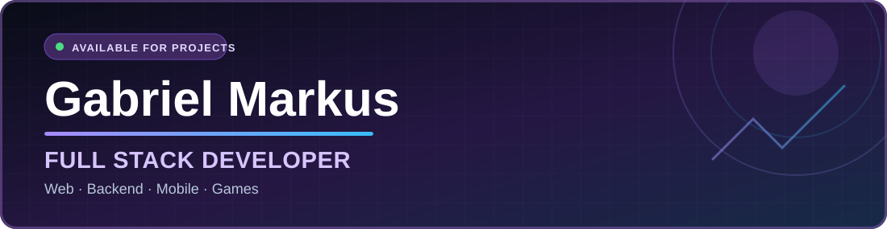
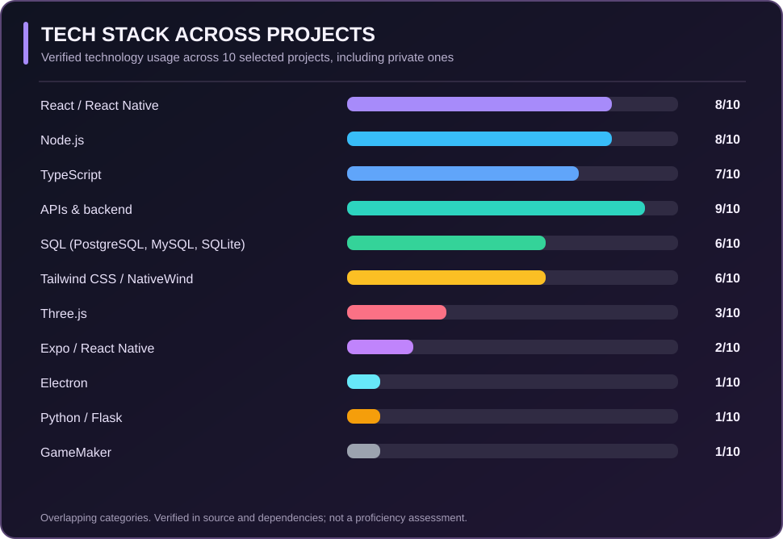
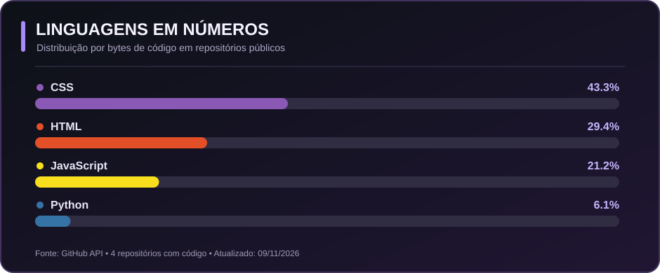
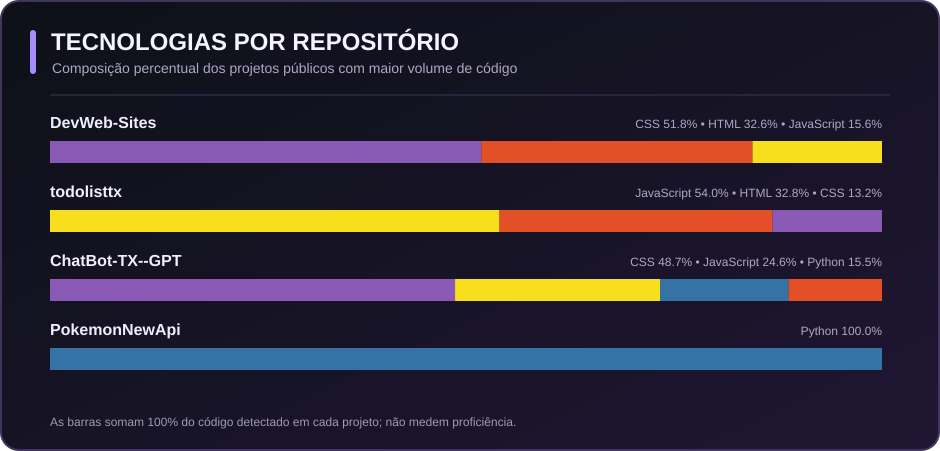

**[🇧🇷 Ler em português](./README.md)** &nbsp; | &nbsp; **🇺🇸 English**

## 👨‍💻 Full-Stack Engineering for Businesses and Digital Products

I'm **Gabriel Markus**, a **Full Stack Developer** working across **frontend and backend engineering**. I build custom software for businesses, mainly through **independent contractor / B2B engagements**.

My work spans the product lifecycle, from application architecture and user interfaces to APIs, integrations, databases, automation, and management dashboards. I've also worked on **web applications, mobile apps, desktop software, and game/simulation projects**.

I focus on translating business requirements into usable, maintainable, and practical software solutions.

**Areas of work:** Business software · E-commerce · CRM · APIs & integrations · Automation · Mobile apps · UI & UX.

---

## 🧰 Technical Stack

| Area | Technologies identified across my projects |
| --- | --- |
| **Languages** | TypeScript, JavaScript, Python, C#, SQL, HTML5, CSS3, GML |
| **Frontend** | React.js, Next.js, Vite, Tailwind CSS, Framer Motion, Three.js, React Flow |
| **Backend & APIs** | Node.js, NestJS, Express, Fastify, Flask, tRPC, REST APIs, Zod |
| **Mobile & Desktop** | React Native, Expo, NativeWind, Electron, GameMaker |
| **Data & Infrastructure** | PostgreSQL, MySQL, SQLite, Prisma, Drizzle ORM, Redis, BullMQ, Docker |
| **Tools & Quality** | Git, GitHub Actions, Vitest, Figma |

Technologies were verified from repository files and documentation, including private projects. This is not a self-assessed proficiency ranking.

### Technologies Across Real Projects

Each bar shows **how many of the 10 selected projects** use the corresponding technology, not skill level. Technology categories can overlap.

---

## 🚀 Featured Projects

Selected professional and technical projects highlighting **full-stack architecture, frontend development, APIs, integrations, and cross-platform engineering**.

<table>
<tr>
<td width="50%" valign="top">
<h3>🛒 Atacadão Studio · Full-Stack Commerce</h3>

Commerce platform connecting storefront, product catalog, inventory, pricing, orders, customer accounts, and a management console.

<code>React.js</code> · <code>Vite</code> · <code>Node.js</code> · <code>PostgreSQL</code> · <code>Tailwind CSS</code> · <code>OpenAI API</code>

🔒 Private source · case study available on request
</td>
<td width="50%" valign="top">
<h3>💼 Sales &amp; Customer Service CRM</h3>

Business CRM for customer relationships, pipeline, customer service, campaigns, catalogs, and digital flyers, with web and mobile interfaces.

<code>React.js</code> · <code>TypeScript</code> · <code>Express</code> · <code>tRPC</code> · <code>MySQL</code> · <code>React Native</code> · <code>Expo</code>

🔒 Private source · case study available on request
</td>
</tr>
<tr>
<td width="50%" valign="top">
<h3>🔁 After-Sales Management Platform</h3>

After-sales platform for workflow automation, data imports, processing queues, campaigns, case management, and operational reporting.

<code>Next.js</code> · <code>NestJS</code> · <code>Fastify</code> · <code>Prisma</code> · <code>PostgreSQL</code> · <code>Redis</code> · <code>BullMQ</code>

🔒 Private source · case study available on request
</td>
<td width="50%" valign="top">
<h3>💬 WhatsApp Messaging Automation</h3>

Customer-engagement tool that imports contact data, identifies birthdays, personalizes campaign artwork, and manages messages through the official API, with queues and audit logs.

<code>React.js</code> · <code>TypeScript</code> · <code>Fastify</code> · <code>Prisma</code> · <code>SQLite</code> · <code>Sharp</code> · <code>WhatsApp Cloud API</code>

🔒 Private source · case study available on request
</td>
</tr>
<tr>
<td width="50%" valign="top">
<h3>🏢 Total Quality Group · Corporate Website</h3>

Corporate website for a consulting and engineering business, featuring service pages, inquiry forms, SEO, and commercial contact integrations.

<code>React.js</code> · <code>TypeScript</code> · <code>Vite</code> · <code>Express</code> · <code>Tailwind CSS</code> · <code>Framer Motion</code>

🔒 Private source · case study available on request
</td>
<td width="50%" valign="top">
<h3>📱 VickMakeup · Business Management App</h3>

Mobile management app for appointments, clients, services, portfolio photos, and reports, with native navigation and local storage.

<code>React Native</code> · <code>Expo</code> · <code>TypeScript</code> · <code>NativeWind</code> · <code>AsyncStorage</code>

🔒 Private source · case study available on request
</td>
</tr>
</table>

### 🔬 Engineering, Desktop & Simulation

<table>
<tr>
<td width="50%" valign="top">
<h3>🖥️ Aurora Next Gen Tools · Desktop</h3>

Local-first desktop companion for strategy simulation workflows, including data imports, generators, visualization tools, and analytics.

<code>React.js</code> · <code>TypeScript</code> · <code>Electron</code> · <code>Express</code> · <code>SQLite</code> · <code>Drizzle ORM</code> · <code>Three.js</code>

🔒 Private source · case study available on request
</td>
<td width="50%" valign="top">
<h3>🌌 Aurora Lore Tools · Worldbuilding</h3>

Full-stack worldbuilding platform for timelines, species, organizations, wiki knowledge, and interactive relationship visualization.

<code>React.js</code> · <code>TypeScript</code> · <code>tRPC</code> · <code>MySQL</code> · <code>Drizzle ORM</code> · <code>React Flow</code> · <code>Three.js</code>

🔒 Private source · case study available on request
</td>
</tr>
<tr>
<td width="50%" valign="top">
<h3>🪐 Orion Explorer · 3D Simulator</h3>

Procedural galaxy and star-system explorer with 3D rendering, planetary inspection, and an interactive simulation interface.

<code>JavaScript</code> · <code>Python</code> · <code>Flask</code> · <code>Three.js</code> · <code>NumPy</code>

🔒 Private source · case study available on request
</td>
<td width="50%" valign="top">
<h3>🎮 SpaceDream · Game Prototype</h3>

2D game project featuring scenes, objects, scripts, sprites, and interactive systems, developed with GameMaker.

<code>GameMaker</code> · <code>GML</code> · <code>Game Development</code>

🔒 Private source · case study available on request
</td>
</tr>
</table>

> **Private repositories:** some projects involve client work or non-public source code. I share high-level descriptions and verified technology stacks without disclosing proprietary source, customer information, or sensitive implementation details. Demos and detailed case studies may be discussed subject to appropriate permission.

---

## 📊 Languages in My Public Repositories

<b>View automatically updated public-code metrics</b>

 

These charts are refreshed by GitHub Actions using **public repositories only**. As much of my professional work lives in private repositories, these figures **do not reflect my full experience**. Percentages measure code volume, not expertise.

## 🤝 Let's Build Something

I develop **business-focused digital products**, from new applications and integrations to the evolution of existing platforms. I'm open to technical collaborations, independent contracts, and full-stack engineering opportunities.

**Have a project or an opportunity in mind?**

📍 Rio de Janeiro, Brazil &nbsp; · &nbsp; Pronouns: he/him

