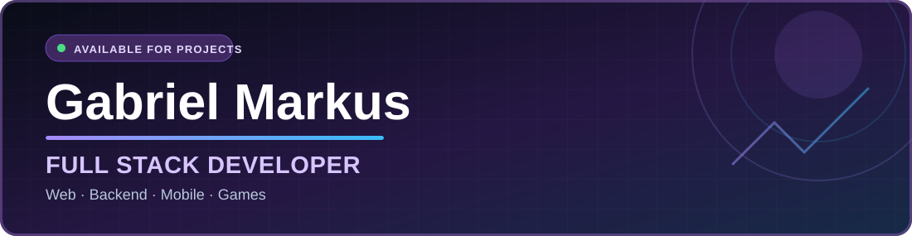
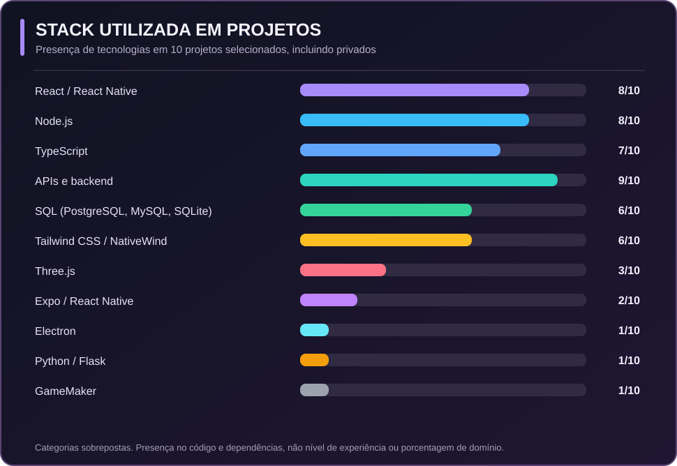
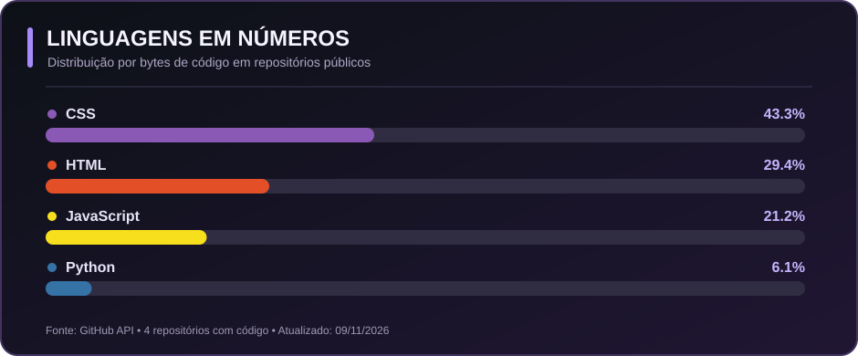
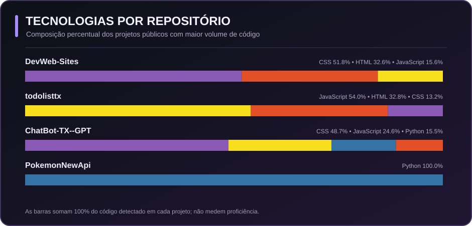

**🇧🇷 Português** &nbsp; | &nbsp; **[🇺🇸 Read in English](./README.en.md)**

## 👨‍💻 Desenvolvimento Full Stack para produtos e empresas

Sou **Gabriel Markus**, desenvolvedor **Full Stack** com atuação em **frontend, backend e desenvolvimento de soluções sob demanda para empresas**, principalmente em projetos como **prestador de serviços (PJ)**.

Trabalho em diferentes etapas do ciclo de um produto: arquitetura de aplicações, criação de interfaces, APIs, integrações, bancos de dados, automações e ferramentas administrativas. Minha experiência inclui **desenvolvimento web, aplicativos mobile, aplicações desktop e projetos de games e simulação**.

Meu foco é transformar necessidades reais de negócio em software funcional, com boa experiência de uso e soluções técnicas sustentáveis.

**Áreas de atuação:** Software empresarial · E-commerce · CRM · APIs e integrações · Automações · Aplicativos mobile · Interfaces e experiência do usuário.

---

## 🧰 Stack técnica

| Área | Tecnologias identificadas nos projetos |
| --- | --- |
| **Linguagens** | TypeScript, JavaScript, Python, C#, SQL, HTML5, CSS3, GML |
| **Frontend** | React.js, Next.js, Vite, Tailwind CSS, Framer Motion, Three.js, React Flow |
| **Backend & APIs** | Node.js, NestJS, Express, Fastify, Flask, tRPC, APIs REST, Zod |
| **Mobile & Desktop** | React Native, Expo, NativeWind, Electron, GameMaker |
| **Dados & infraestrutura** | PostgreSQL, MySQL, SQLite, Prisma, Drizzle ORM, Redis, BullMQ, Docker |
| **Ferramentas & qualidade** | Git, GitHub Actions, Vitest, Figma |

Stack verificada a partir dos arquivos e documentações dos repositórios, incluindo projetos privados. Tecnologias listadas não representam uma classificação de proficiência.

### Tecnologias em projetos reais

As barras indicam **em quantos dos 10 projetos selecionados** uma tecnologia aparece, e não porcentagem de domínio. Um projeto pode utilizar várias tecnologias.

---

## 🚀 Projetos em destaque

Soluções desenvolvidas em contextos profissionais, comerciais e de produto. Selecionei projetos que demonstram **arquitetura Full Stack, desenvolvimento de interfaces, APIs, integração de sistemas e experiência multiplataforma**.

<table>
<tr>
<td width="50%" valign="top">
<h3>🛒 Atacadão Studio · E-commerce Full Stack</h3>

Plataforma de comércio digital com vitrine, catálogo, estoque, precificação, pedidos, área do cliente e painel administrativo. Integra a operação da loja às ferramentas de gestão.

<code>React.js</code> · <code>Vite</code> · <code>Node.js</code> · <code>PostgreSQL</code> · <code>Tailwind CSS</code> · <code>OpenAI API</code>

🔒 Código privado · case disponível sob solicitação
</td>
<td width="50%" valign="top">
<h3>💼 CRM Comercial &amp; Atendimento</h3>

Sistema para gestão de relacionamento, pipeline, atendimento, campanhas, catálogo e encartes digitais, com aplicação web e módulo mobile.

<code>React.js</code> · <code>TypeScript</code> · <code>Express</code> · <code>tRPC</code> · <code>MySQL</code> · <code>React Native</code> · <code>Expo</code>

🔒 Código privado · case disponível sob solicitação
</td>
</tr>
<tr>
<td width="50%" valign="top">
<h3>🔁 Plataforma de Pós-venda</h3>

Solução de pós-venda com automações, importação de dados, filas de processamento, campanhas e acompanhamento de atendimentos por indicadores.

<code>Next.js</code> · <code>NestJS</code> · <code>Fastify</code> · <code>Prisma</code> · <code>PostgreSQL</code> · <code>Redis</code> · <code>BullMQ</code>

🔒 Código privado · case disponível sob solicitação
</td>
<td width="50%" valign="top">
<h3>💬 Automação de Mensagens · WhatsApp</h3>

Ferramenta de relacionamento que importa contatos, identifica aniversariantes, personaliza artes e organiza envios via API oficial com fila e auditoria.

<code>React.js</code> · <code>TypeScript</code> · <code>Fastify</code> · <code>Prisma</code> · <code>SQLite</code> · <code>Sharp</code> · <code>WhatsApp Cloud API</code>

🔒 Código privado · case disponível sob solicitação
</td>
</tr>
<tr>
<td width="50%" valign="top">
<h3>🏢 Total Quality Group · Website Corporativo</h3>

Site institucional para empresa de consultoria e engenharia, com páginas de serviços, formulários de proposta, SEO e integração comercial.

<code>React.js</code> · <code>TypeScript</code> · <code>Vite</code> · <code>Express</code> · <code>Tailwind CSS</code> · <code>Framer Motion</code>

🔒 Código privado · case disponível sob solicitação
</td>
<td width="50%" valign="top">
<h3>📱 VickMakeup · App de Gestão</h3>

Aplicativo mobile para gestão de agenda, clientes, serviços, galeria de resultados e relatórios, com navegação e armazenamento local.

<code>React Native</code> · <code>Expo</code> · <code>TypeScript</code> · <code>NativeWind</code> · <code>AsyncStorage</code>

🔒 Código privado · case disponível sob solicitação
</td>
</tr>
</table>

### 🔬 Engenharia, desktop e simulação

<table>
<tr>
<td width="50%" valign="top">
<h3>🖥️ Aurora Next Gen Tools · Desktop</h3>

Suite desktop para auxiliar fluxos de simulação estratégica, incluindo importação de dados, ferramentas de geração, visualizações e análises locais.

<code>React.js</code> · <code>TypeScript</code> · <code>Electron</code> · <code>Express</code> · <code>SQLite</code> · <code>Drizzle ORM</code> · <code>Three.js</code>

🔒 Código privado · case disponível sob solicitação
</td>
<td width="50%" valign="top">
<h3>🌌 Aurora Lore Tools · Worldbuilding</h3>

Plataforma Full Stack para construção de universos ficcionais, linhas do tempo, espécies, organizações, wiki e visualização de relações.

<code>React.js</code> · <code>TypeScript</code> · <code>tRPC</code> · <code>MySQL</code> · <code>Drizzle ORM</code> · <code>React Flow</code> · <code>Three.js</code>

🔒 Código privado · case disponível sob solicitação
</td>
</tr>
<tr>
<td width="50%" valign="top">
<h3>🪐 Orion Explorer · Simulador 3D</h3>

Explorador de galáxias e sistemas estelares com geração procedural, renderização 3D, inspeção de planetas e interface interativa.

<code>JavaScript</code> · <code>Python</code> · <code>Flask</code> · <code>Three.js</code> · <code>NumPy</code>

🔒 Código privado · case disponível sob solicitação
</td>
<td width="50%" valign="top">
<h3>🎮 SpaceDream · Protótipo de Game</h3>

Projeto de jogo 2D com estrutura de cenas, objetos, scripts, sprites e sistemas interativos, desenvolvido no ecossistema GameMaker.

<code>GameMaker</code> · <code>GML</code> · <code>Game Development</code>

🔒 Código privado · case disponível sob solicitação
</td>
</tr>
</table>

> **Sobre os repositórios privados:** alguns projetos envolvem trabalhos para empresas ou código não publicado. Por isso, apresento suas características técnicas sem expor o código-fonte, informações de clientes ou detalhes internos. Demonstrações e estudos de caso podem ser discutidos conforme a autorização aplicável.

---

## 📊 Linguagens dos meus repositórios públicos

<b>Visualizar métricas automáticas de código público</b>

 

Esses gráficos são atualizados automaticamente pelo GitHub Actions e consideram apenas repositórios **públicos** com código. Como parte significativa do trabalho profissional está em repositórios privados, **as porcentagens públicas não representam toda a minha experiência**. A medida utilizada é volume de código detectado, não nível de conhecimento.

## 🤝 Projetos, parcerias e oportunidades

Atuo na construção de **soluções digitais para empresas**, desde novas aplicações e integrações até evolução de plataformas existentes. Tenho interesse em colaborações técnicas, contratos PJ e oportunidades de desenvolvimento Full Stack.

**Vamos conversar sobre seu projeto ou oportunidade?**

📍 Rio de Janeiro, Brasil &nbsp; · &nbsp; Pronomes: ele/dele

